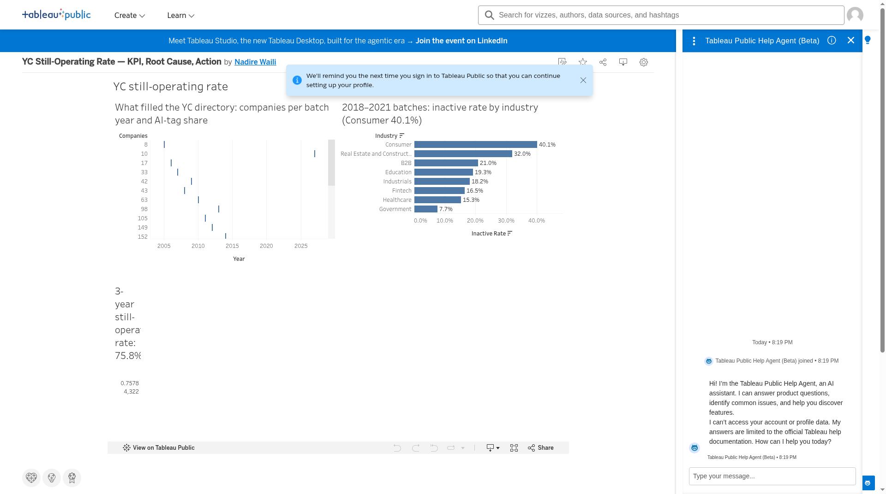

# YC still-operating rate: KPI, root cause and action

**Live dashboard:** [Tableau Public](https://public.tableau.com/app/profile/nadire.waili/viz/YCStill-OperatingRateKPIRootCauseAction/Dashboard1_1)

## Question and KPI
What share of Y Combinator companies are still operating once their cohort is old enough to measure?

**KPI:** the still-operating rate for batches up to Summer 2023 is **75.8%** (3,275 of 4,322 companies). The dataset holds 6,378 companies in total.

## Root cause
Inactive rate by industry, 2018–2021 batches:

| Industry | Inactive | Rate |
|---|---|---|
| Consumer | 101 of 252 | 40.1% |
| B2B | 167 of 797 | 21.0% |
| Fintech | 40 of 242 | 16.5% |
| Healthcare | 44 of 287 | 15.3% |

## Trend
The AI-tag share of batches rose from 21.8% in 2021 to 64.1% in 2024.

## Action
Score a YC-style portfolio on the 3-year still-operating rate by industry, not on this year's headcount of AI tags. Do not copy consumer marketplaces from the famous public companies (Airbnb, Instacart, DoorDash sit in Consumer and they are the exceptions). The first cut is Consumer versus Fintech and Healthcare in any cohort that is old enough to measure.

## Contents
- `data/` – tidy CSVs and the Excel workbook used in Tableau
- `story/index.html` – the analysis written up as a web story
- `images/dashboard.png` – dashboard screenshot

## Tools
Python (data prep), Tableau Public, Excel/CSV.

## Data source
Public Y Combinator directory via the yc-oss/api dump of the Algolia index, as listed on ycombinator.com/companies.
